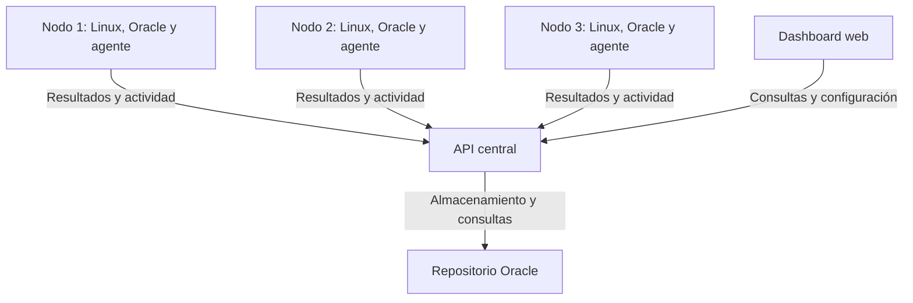

# PDC-Monitoreo-Distribuido
## Sistema distribuido de monitoreo de servidores y bases de datos

Proyecto académico para la materia **Programación Distribuida y Componentes**.

## Descripción

El proyecto propone centralizar el monitoreo de varios servidores Linux y de las bases de datos Oracle que alojan. Su objetivo es que operadores de infraestructura y administradores de bases de datos puedan consultar el estado de los recursos desde una interfaz web, sin ingresar individualmente a cada servidor.

Cada servidor ejecutará un agente independiente que recolectará información, calculará métricas y evaluará umbrales localmente. Los resultados se enviarán a una API central para su almacenamiento y visualización.

## Arquitectura propuesta

El laboratorio inicial contempla **tres nodos monitoreados y un nodo central**.

- **Agentes:** ejecutarán controles periódicos, procesarán las mediciones y clasificarán los resultados como `OK`, `WARNING` o `CRITICAL`.
- **API central:** recibirá los resultados, entregará configuración y consolidará la información de los distintos nodos.
- **Repositorio:** conservará servidores, bases, controles, configuración y mediciones históricas.
- **Dashboard:** permitirá consultar estados, detalles y condiciones de alerta, y modificar frecuencias y umbrales.

El dashboard se comunicará únicamente con la API. Los agentes accederán a las bases monitoreadas desde sus respectivos servidores.

Si un agente deja de enviar señales de actividad (*heartbeat*), el sistema indicará **SIN CONTACTO** y mostrará la antigüedad de sus datos. Los demás agentes continuarán funcionando. La falta de contacto no permite determinar por sí sola si falló el agente, la red o el servidor.

## Alcance inicial

- Tres agentes independientes y una API REST central.
- Cuatro o cinco controles de disponibilidad, latencia, uso de disco, tablespaces y bloqueos.
- Procesamiento local y evaluación de umbrales.
- Frecuencias y umbrales configurables.
- Dashboard general y detalle de los recursos, con fecha de última actualización.
- Almacenamiento de mediciones para consultar el histórico.
- Demostración de pérdida de contacto de un agente sin interrumpir a los demás.

## Tecnologías propuestas

| Componente | Tecnología |
|---|---|
| Agentes y API central | Java y Spring Boot |
| Repositorio central | Oracle Database Free |
| Interfaz web | React |
| Comunicación | API REST con mensajes JSON |
| Acceso a Oracle | JDBC |
| Organización del despliegue | Docker Compose |
| Entorno de los nodos monitoreados | Linux |

Estas tecnologías están sujetas a validación durante la preparación del laboratorio. Si los nodos se alojan en computadoras diferentes, se evaluará una red privada para conectarlos.

## Organización prevista del repositorio

| Carpeta | Contenido previsto |
|---|---|
| `docs/entrega-0/` | Plan del proyecto |
| `docs/entrega-1/` | Informe, esquema técnico y presentación de arquitectura |
| `agent/` | Agente de monitoreo |
| `api/` | Servicios centrales |
| `dashboard/` | Interfaz web |
| `database/` | Scripts y documentación de datos |
| `contracts/` | Contratos REST y formatos de mensajes |
| `deploy/` | Configuración e instrucciones de despliegue |

Las carpetas se incorporarán a medida que avance el proyecto. La documentación de las siguientes entregas se organizará con el mismo criterio.

## Equipo

| Integrante | Responsabilidad principal |
|---|---|
| Sabrina Vicente | API, frontend e integración con el repositorio |
| Jorge Cubiló | Agente distribuido y comunicación REST |
| Andres Graglia | Oracle, modelo de datos y QA |

Los tres integrantes participarán en diseño, revisión, integración, pruebas, documentación y demostración.

## Estado del proyecto

El proyecto se encuentra en etapa de definición y propuesta de arquitectura. Este repositorio reunirá la documentación y, posteriormente, la implementación.

Las instrucciones de instalación y ejecución se incorporarán cuando exista una versión funcional.

## Mejoras previstas

- Buffer persistente local con SQLite y reenvío de resultados pendientes.
- Notificaciones por correo.
- Autenticación de usuarios.
- Gráficos históricos.
- Alta disponibilidad de los servicios centrales.

Estas mejoras quedan fuera del alcance inicial. La primera versión mantendrá una API y un repositorio central, por lo que todavía no contempla alta disponibilidad.
